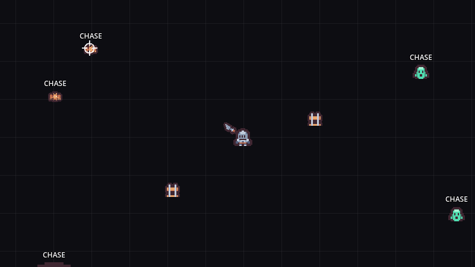
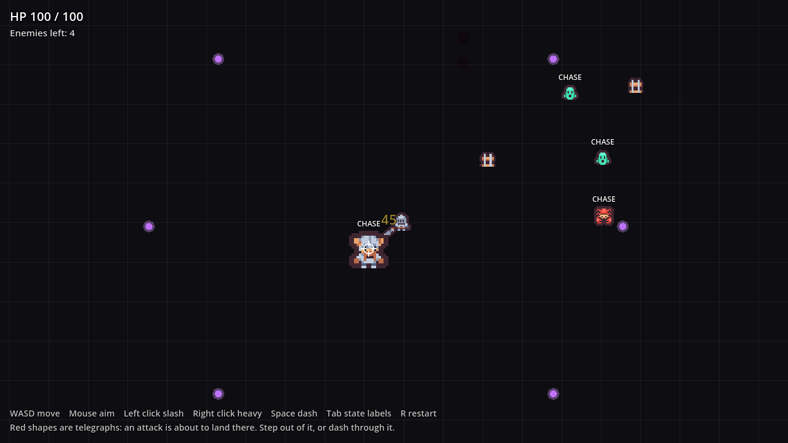

# Godot Enemy AI

2D enemy AI for Godot 4: one shared state machine, readable telegraphed attacks,
four enemy types and a three-pattern boss, all fighting you in one arena.



The label over each enemy is its current state. The crosshair stands in for your
mouse.

## Features

- **One state machine for every enemy:** `IDLE`, `CHASE`, `TELEGRAPH`, `ATTACK`,
  `RECOVERY` and `DEAD`, in `EnemyBase`. Each enemy type only writes its own
  `_ai_process()`.
- **Telegraphs you can read:** a pulsing red circle or a red line shows where an
  attack is about to land, so every hit can be dodged.
- **Four behaviours:**
  - **Grunt** chases, stops, flashes a ring and swings.
  - **Skitterling** weaves toward you and snaps with a very short telegraph.
  - **Charger** locks a direction, shows a long line, then dashes down it.
  - **Boss** cycles a ground slam, a ring of projectiles and a line charge, and
    enrages below half health with faster wind-ups and denser volleys.
- **Knockback with hit-stun,** so a hit replaces an enemy's motion instead of
  stacking on top of a charge.
- **Juice:** squash on hit, wall-slam sparks, and a death pop with gibs, a ring
  and a splat left on the floor.
- **Extras ready to call:** `make_elite()` for a tougher glowing variant,
  `ignite(dps, seconds)` for burn damage, `chill(factor, seconds)` for a slow,
  and `spawn_in()` for an entrance effect.
- **The combat it plugs into:** health, hitbox and hurtbox components, a sword
  with a quick and a heavy attack, and a dash with i-frames.

## Demo



`Main.tscn` drops you into an arena with two Grunts, two Skitterlings, a Charger
and the boss. Your health and the enemy count are in the top left.

Press **Tab** to hide or show the state labels and **R** to restart. The fight is
meant to be hard, so the labels are there to help you read it.

## Requirements

- Godot **4.7** or later, standard build (GDScript only, no .NET needed).
- Tested on **Godot 4.7.2 stable** on Windows. Earlier 4.x versions are untested.
- Uses the Mobile renderer, which needs Vulkan, Direct3D 12 or Metal.

## Installation

Clone the repository:

```bash
git clone https://github.com/CodingQuests/godot-enemy-ai.git
```

Or download it with **Code > Download ZIP** and unzip it.

Then open Godot, click **Import**, pick the `project.godot` file inside the folder,
and click **Import & Edit**.

## Quick Start

1. Press **F5**.
2. Move with **WASD**, aim with the **mouse**.
3. **Left click** to slash, **right click** for a heavy attack, **Space** to dash.
4. Watch the labels: when an enemy says `TELEGRAPH`, its attack is coming. Step
   out of the red shape, or dash through it.

## How It Works

### One base, small subclasses

`EnemyBase.gd` owns everything every enemy shares: health, the hurtbox, the
attack hitbox, knockback and hit-stun, telegraph drawing, facing the player, the
idle bob and death. Its `_physics_process()` calls one override point:

```gdscript
# Override points for subclasses.
func _on_ready() -> void:
	pass


func _ai_process(_delta: float) -> void:
	pass
```

A subclass sets its stats in `_on_ready()` and runs its state machine in
`_ai_process()`. Here is the Grunt's:

```gdscript
func _ai_process(delta: float) -> void:
	if _cd > 0.0:
		_cd -= delta

	match state:
		State.IDLE, State.CHASE:
			velocity = dir_to_player() * speed
			if has_player() and distance_to_player() <= attack_range and _cd <= 0.0:
				_enter_telegraph()
		State.TELEGRAPH:
			velocity = velocity.move_toward(Vector2.ZERO, 700 * delta)
			state_timer -= delta
			if state_timer <= 0.0:
				_enter_attack()
		State.ATTACK:
			state_timer -= delta
			if state_timer <= 0.0:
				_enter_recovery()
		State.RECOVERY:
			velocity = velocity.move_toward(Vector2.ZERO, 700 * delta)
			state_timer -= delta
			if state_timer <= 0.0:
				state = State.CHASE
```

Each `_enter_*()` function sets the state, starts its timer and does the one
thing that state is for: show the telegraph, enable the attack hitbox, or turn it
off again.

### The tools a subclass gets

| Call | What it does |
|---|---|
| `dir_to_player()`, `distance_to_player()`, `has_player()` | Where the player is |
| `show_telegraph_circle(radius)` | A pulsing red circle around the enemy |
| `show_telegraph_rect(length, width, direction)` | A pulsing red line, for charges |
| `hide_telegraph()` | Clear it |
| `enable_attack_area(offset, radius)` | Turn the attack hitbox on, sized for this attack |
| `_disable_attack_area()` | Turn it off |

### Why the telegraph matters

An attack you cannot see coming feels unfair even when the numbers are fine. Every
attack here waits in `TELEGRAPH` first, and `RECOVERY` afterwards leaves a window
to punish. Tuning `telegraph_time` and `recovery_time` changes how fair an enemy
feels more than its damage does.

### Damage

Enemies use the same components as the player. The attack is a
`HitboxComponent` on the `enemy_hitbox` layer, and each enemy takes damage
through its own `HurtboxComponent`. The physics layers are named in
`project.godot`, so you can read them in the Inspector.

## Project Structure

```
project.godot                  Project file, layer names, input actions, GameManager autoload
Main.tscn                      The demo arena
scenes/EnemyBase.tscn          The shared enemy scene: body, sprite, Health, Hurtbox, AttackArea, Telegraph
scenes/GruntEnemy.tscn         Inherited scenes that swap the sprite and script
scenes/SkitterlingEnemy.tscn
scenes/ChargerEnemy.tscn
scenes/BossEnemy.tscn
scenes/Projectile.tscn         The boss's projectile
scripts/EnemyBase.gd           The shared state machine, telegraphs, knockback, death
scripts/GruntEnemy.gd          The four behaviours
scripts/SkitterlingEnemy.gd
scripts/ChargerEnemy.gd
scripts/BossEnemy.gd
scripts/Projectile.gd          A projectile that acts as a hitbox
scripts/HealthComponent.gd     Health, damage, heal and the died signal
scripts/HitboxComponent.gd     Deals damage
scripts/HurtboxComponent.gd    Receives damage, knockback and hit feedback
scripts/Player.gd              The player: movement, dash with i-frames, attacks
scripts/WeaponController.gd    The sword: quick and heavy attacks
scripts/GameManager.gd         Autoload: shake, hit-stop, camera kick, zoom punch
scripts/PlayerCamera.gd        The follow camera
scripts/Juice.gd               Static effect helpers
shaders/flash.gdshader         The white hit flash
scripts/Main.gd                Demo only: grid, health readout, state labels, restart
Assets/Tiles/                  Kenney Tiny Dungeon tiles (CC0) and their license
```

## Using It In Your Own Game

1. Copy `scripts/` and `shaders/` into your project, plus `scenes/EnemyBase.tscn`
   and whichever enemy scenes you want.
2. Add `scripts/GameManager.gd` as an autoload named `GameManager`.
3. Put your player in the `player` group. Enemies find it with
   `get_tree().get_first_node_in_group("player")`.
4. Give your player a `HurtboxComponent` on the `player_hurtbox` layer with its
   mask on `enemy_hitbox`, so enemy attacks can land.
5. Copy the `[layer_names]` section of `project.godot` into yours, or set the
   same layer numbers by hand.

To make a new enemy, make an inherited scene from `EnemyBase.tscn`, swap the
sprite, and attach a script that `extends EnemyBase`. Copy `GruntEnemy.gd` as a
starting point.

The boss fires into a node in the `projectiles` group if there is one, so add a
`Node2D` in that group to keep projectiles together.

## Customizing It

- **Stats:** each enemy sets `max_health`, `speed`, `attack_damage` and
  `attack_knockback` in `_on_ready()`.
- **Fairness:** the exported wind-up (`telegraph_time`, or `windup_time` on the
  Charger), `recovery_time` and cooldown on each enemy type.
- **Reach:** `attack_range` on the Grunt and Skitterling, `charge_range` and
  `charge_speed` on the Charger.
- **Boss difficulty:** `set_level(level)` adds health and damage per level, and
  `_enraged()` decides when it gets faster.
- **Elites:** call `make_elite()` on any enemy after it is in the scene.

## Known Limitations

- Enemies steer straight at the player. There is no pathfinding, so walls between
  you and an enemy will block it. Add a `NavigationAgent2D` for levels with
  obstacles.
- Enemies always know where the player is. There is no line of sight or hearing.
- One player only: enemies target the first node in the `player` group.
- No sound. `EnemyBase._on_hurt()` and `die()` are the natural places to play one.
- Status effects (`ignite`, `chill`) and `make_elite()` are ready to call but
  nothing in the demo uses them.
- Tested on Godot 4.7.2 on Windows only.

## License

MIT for the code. See [LICENSE](LICENSE).

## Third-Party Assets

All sprites are from [Tiny Dungeon](https://kenney.nl/assets/tiny-dungeon) by
Kenney, released under CC0 1.0. Details in
[THIRD_PARTY_ASSETS.md](THIRD_PARTY_ASSETS.md), and the pack's original license is
in `Assets/Tiles/License.txt`.

## Learn How It Works

Want to understand how this works instead of just copying it?

CodingQuests teaches you how to build systems like this step by step in Godot,
with interactive lessons and real projects.

- **[2D Roguelike: Enemies & AI](https://codingquests.io/quests/2d-roguelike-enemies-ai?utm_source=github&utm_medium=resource&utm_campaign=godot_enemy_ai)**
  builds this enemy system lesson by lesson: the shared state machine, the
  telegraphs, each enemy type and the boss. The first 3 lessons are free.
- **[2D Roguelike: Combat Core](https://codingquests.io/quests/2d-roguelike-combat-core?utm_source=github&utm_medium=resource&utm_campaign=godot_enemy_ai)**
  covers the health, hitbox and hurtbox components these enemies are built on. The first 4 lessons are free.

## More Free Godot Resources from CodingQuests

Other free, MIT-licensed Godot 4 projects that work well next to this one:

- **[State Machine](https://github.com/CodingQuests/godot-state-machine)**: A node-per-state machine, shown on a slime that idles, roams, chases, leaps, staggers and dies.
- **[Hitbox and Hurtbox](https://github.com/CodingQuests/godot-hitbox-hurtbox)**: Health, hitbox and hurtbox components with one hit per swing, knockback, hit-stop and i-frames.
- **[Top-Down Controller](https://github.com/CodingQuests/godot-top-down-controller)**: 8-direction movement, mouse aim, a dash with i-frames and a follow camera with shake.
- **[Game Feel Lab](https://github.com/CodingQuests/godot-game-feel-lab)**: One sword swing split into seven layers you can switch on and off while the game runs.

All twelve are listed on the [CodingQuests GitHub profile](https://github.com/CodingQuests).

Made by [CodingQuests](https://codingquests.io/?utm_source=github&utm_medium=resource&utm_campaign=godot_enemy_ai).
